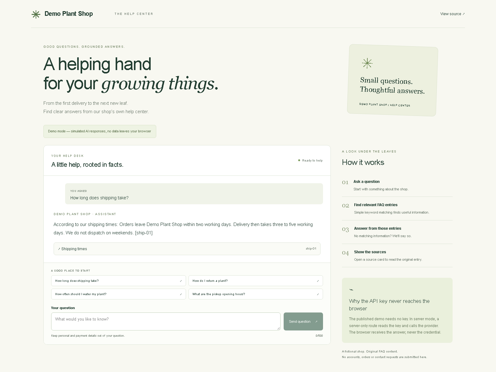

# Next.js AI Support Assistant

**Demo Plant Shop help center**



[Live demo](https://massimilianoborgatti.github.io/nextjs-ai-support-assistant/) · [Repository](https://github.com/massimilianoborgatti/nextjs-ai-support-assistant)

## What this demonstrates

- Answers based only on the shop's FAQ, with expandable source cards.
- Server-side API key handling, a rate limit, a request timeout and generic error messages.
- A contact fallback for off-topic questions and refusals for obvious instruction overrides.
- A full test suite and CI that run without credentials or provider calls.

## How it works

The public demo uses deterministic simulated responses entirely in the browser. A separate local server mode connects the same retrieval pipeline to a configurable provider.

```text
Question → keyword retrieval → up to three FAQ entries
                              ↓
                       mock / server generator
                              ↓
                       streamed answer + sources
```

The server prompt separates rules from delimited FAQ data and user input. Prompt boundaries are not a guarantee against every injection or unsupported claim. Sources include only retrieved ids cited in the answer. Citation ids are removed from visible text, including ids split across streamed chunks; expandable source cards remain available. Evaluate model answers before consequential use.

## Retrieval details

- Twenty original FAQ entries cover the fictional shop. Retrieval normalizes common word forms and pickup phrasing while keeping quantity questions distinct from price questions.
- Multi-word tags and optional `requires` terms match contiguous phrases, including internal stop words. The `requires` terms constrain entries that depend on context.
- A specific topic term or full intent phrase must match a title or tag. Generic words cannot select an entry on their own. Body overlap has a small effect on ranking after an entry qualifies.
- A confident match requires a clear score margin. Ambiguous questions offer two FAQ titles to choose from. Unrelated and unsupported questions get the contact fallback.
- The browser mock quotes the top FAQ entry. Obvious instruction overrides receive a refusal.

## Evaluation

On the fixtures in [the retrieval evaluation](tests/retrieval-eval.test.ts), all 70 labeled questions matched their expected outcome. The expected FAQ entry ranked first for 55 questions, and 15 correctly returned no top entry. The same file also checks normalization, ambiguity, context requirements and refusals.

```sh
npm test -- tests/retrieval-eval.test.ts
```

## Development

### Run locally

Use Node.js 24 LTS and npm.

```sh
npm ci
npm run dev
```

Open http://127.0.0.1:3000. Without a key, answers use the browser mock. History exists only in component memory and disappears on reload.

For server mode, copy `.env.example` to `.env.local`, replace `your-api-key-here` with your server credential and optionally set `OPENAI_MODEL`. Restart the development server. The mode badge explains that questions go to the provider. Never use a public environment variable for credentials.

```sh
npm run build
npm start
```

The normal build includes `POST /api/assist`. It validates questions, applies a shared process-local limit of ten requests per minute, sets a twenty-second timeout and returns generic errors with no-store headers. The shared bucket is conservative for local use; forwarded client headers are not trusted.

### Static demo

```sh
npm run build:pages
npm run preview
```

Open http://127.0.0.1:4500/nextjs-ai-support-assistant/. The export excludes TypeScript route handlers using page extensions and renders the browser mock regardless of server environment settings. Run a normal build again before `npm start`.

### Tests

```sh
npm run format:check
npm run lint
npm run typecheck
npm test
npm run build
npm run build:pages
npx playwright install chromium
npm run e2e
npm run screenshots
```

Unit tests cover retrieval, prompt boundaries, mock streaming, sources, unsupported questions, refusals, validation, limits, timeout, generic failures, logging and the chat UI. Browser tests use the static build under its deployed base path, check narrow screens and assert that requests stay on the local origin. No test needs credentials or calls a provider.

CI checks pull requests and main pushes without secrets. Pages deploys only after successful main push CI from the same repository. Two portfolio screenshots are generated from the static build.

## Production notes

- Store credentials in server environment settings. Keep them out of browser bundles, responses and logs.
- Replace the process-local limit with a shared store and a trusted client identifier before scaling. Add authentication, edge request-size enforcement and abuse monitoring for a public API.
- Set provider budgets, alerts and request limits. Output tokens, disabled retries and timeout bound individual requests; they are not a total spending cap.
- Log duration and status, avoiding questions and personal information.
- Obtain consent before sending personal data to a provider. Visitors are asked to omit personal and payment details. Response storage is disabled, but provider retention policies still need review.
- Implement `AnswerGenerator` to swap providers. The server adapter streams Responses API text deltas: [streaming documentation](https://developers.openai.com/api/docs/guides/streaming-responses).
- Evaluate retrieval on representative support questions, validate citations and add human escalation for real support. Keyword relevance does not establish that every part of a question is covered. The mock is an extractive demonstration.

## Stack and license

Next.js App Router, React, strict TypeScript, Vitest, React Testing Library, Playwright, ESLint and Prettier. Versions are recorded in `package-lock.json`.

[MIT](LICENSE)

Built by Massimiliano Borgatti — [LinkedIn](https://www.linkedin.com/in/massimilianoborgatti/)
